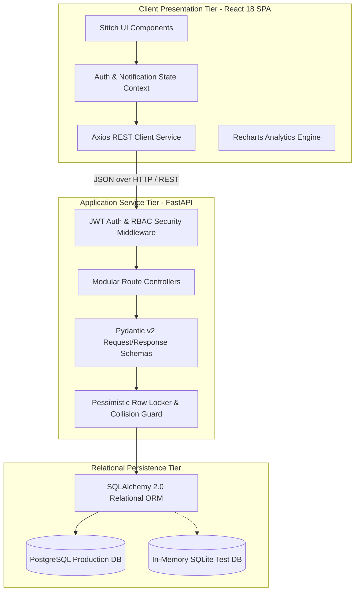
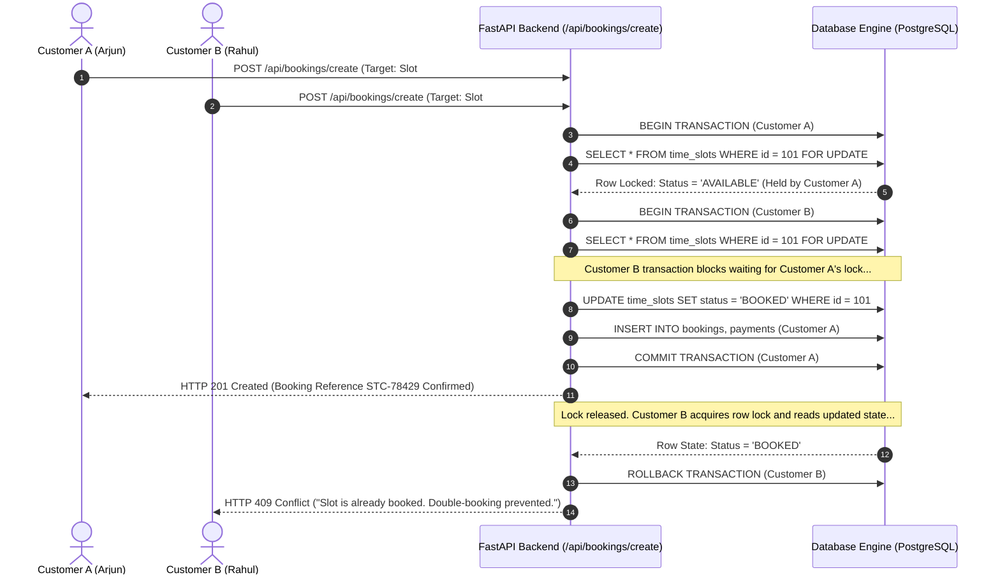
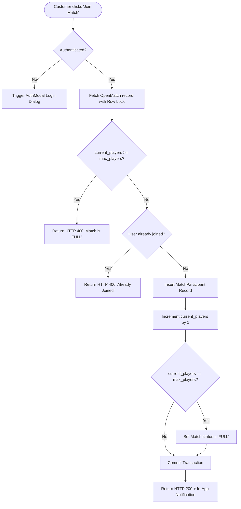
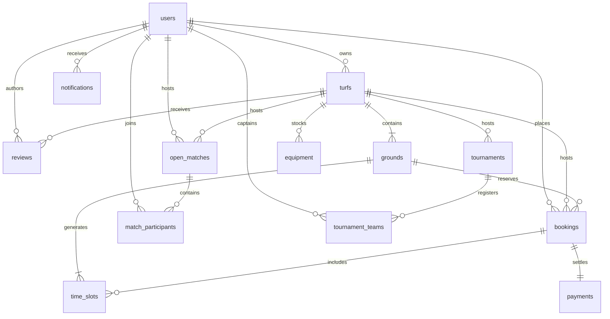

# PLAYSPORT — System Architecture, Project Blueprint & Engineering Dossier
> **AI Context & Technical Project Specification Document**  
> *This document provides an exhaustive, self-contained overview of the PLAYSPORT platform. Any AI model or software engineer reading this will fully understand the project's identity, mission, software architecture, concurrency algorithms, file structure, pros and design strengths, database schema, and automated test coverage.*

---

## 1. Project Identification & Core Mission

### 1.1 What is PLAYSPORT?
**PLAYSPORT** is an enterprise-grade, full-stack Sports Facility Management and Athlete Matchmaking web platform. It digitizes the recreational sports ecosystem by providing real-time hourly turf pitch reservations, athlete social matchmaking (Open Matches), knockout/league tournament registrations, and sports equipment rentals.

Built strictly according to the **Google Stitch UI/UX design specifications**, the platform combines an asynchronous **FastAPI (Python 3.9+)** REST backend with a reactive **React 18 (Vite + Tailwind CSS)** Single Page Application (SPA), backed by **SQLAlchemy 2.0 ORM** with **PostgreSQL** in production and isolated in-memory **SQLite** during automated test execution.

### 1.2 Core Goals & Purpose
1. **Eliminate Double-Bookings:** Replace error-prone telephone and manual WhatsApp turf bookings with an automated, race-condition-proof reservation engine.
2. **Solve the "Missing Player" Problem:** Provide an Open Match matchmaking arena where individual athletes without a full team can join casual and competitive lobbies with real-time capacity clamping.
3. **Empower Facility Owners:** Provide turf managers with live pitch utilization monitors, multi-day batch time-slot generators, and automated revenue ledgers.
4. **Ensure Regulatory & Platform Quality:** Provide platform administrators with an onboarding queue to vet and approve legitimate turf businesses before listings go live.
5. **Demonstrate Enterprise-Grade Quality (10/10):** Enforce code correctness and resilience through a complete Testing Pyramid consisting of backend unit/integration tests, frontend component tests, and deep Selenium WebDriver End-to-End (E2E) browser automation.

### 1.3 User Personas & Role Matrix
The platform enforces strict Role-Based Access Control (RBAC) across four distinct roles:

| Role | Primary Persona | System Capabilities |
|---|---|---|
| **Super Admin** (`ADMIN`) | Platform Overseer | Approves/rejects turf owner applications, inspects platform-wide KPI metrics and Recharts revenue trendlines, moderates users and venues. |
| **Turf Owner** (`OWNER`) | Commercial Facility Manager | Manages venue profiles, pitches/grounds, batch-generates calendar slots, monitors live pitch indicators, manages hosted open matches. |
| **Turf Staff** (`STAFF`) | On-Site Receptionist | Verifies digital customer booking references at facility gates, checks in players, toggles pitch availability. |
| **Customer Athlete** (`CUSTOMER`) | Sports Player | Searches turfs by sport/city, books hourly slots, generates digital invoices with confetti, joins open matches, rents gear, submits reviews. |

---

## 2. Key Architectural Strengths & Pros

### 1. Zero Double-Booking Guarantee (Pessimistic Locking)
- **Problem Solved:** Two customers attempting to reserve the exact same pitch for the same date and hour at the same millisecond.
- **Architectural Solution:** Rather than relying on optimistic checks that fail under load, the booking engine uses database-level row locking (`SELECT ... FOR UPDATE`) within an atomic transaction. A unique database constraint `(ground_id, slot_date, start_time)` acts as an immutable secondary guardrail. Conflicts immediately roll back and return a clean `HTTP 409 Conflict`.

### 2. High-Performance Asynchronous Service Tier
- **FastAPI + Async I/O:** The Python backend leverages asynchronous event loops and Uvicorn ASGI workers, minimizing request latency and memory footprint compared to synchronous frameworks.
- **Pydantic v2 Type Safety:** All incoming request payloads and outgoing JSON responses are validated through Pydantic models with strict typing, guaranteeing data contracts between client and server.

### 3. Decoupled, Framework-Agnostic 3-Tier Architecture
- Clean separation between presentation (React 18 SPA), business logic (FastAPI route controllers & services), and data persistence (SQLAlchemy 2.0 ORM).
- The REST API adheres to OpenAPI 3.0 standards, making it plug-and-play for web, mobile apps, or third-party integrations.

### 4. Enterprise Testing Pyramid (10/10 QA Grade)
- **Multi-Layered Verification:** Tests are not restricted to surface-level checks. The project includes:
  - Backend integration tests using an isolated in-memory SQLite fixture (fast, hermetic, zero database pollution).
  - Frontend component tests using Vitest and JSDOM (headless DOM testing of React components).
  - Deep End-to-End (E2E) browser tests using Selenium WebDriver (14 automated test cases covering authentication, routing, slot selection, and booking checkout with a 100% pass rate).

### 5. Google Stitch UI/UX Design System
- Modern, high-contrast, responsive interface built with Tailwind CSS, custom gradients, interactive date carousels, status badges, and animated celebration effects (`canvas-confetti`).

### 6. Clean Extensibility for Future Major Project Extensions
- The database schema and modular routing architecture are designed to seamlessly integrate upcoming features (AI-driven dynamic slot pricing, machine learning demand forecasting, skill-based athlete ELO rating algorithms, and live WebSockets) without restructuring existing data models.

---

## 3. System Architecture & Engineering Design

### 3.1 High-Level 3-Tier Architecture



---

### 3.2 Concurrency Control & Double-Booking Prevention Algorithm

The reservation workflow guarantees transactional ACID isolation when booking time slots:



#### Algorithm Steps:
1. **Acquire Pessimistic Locks:** The API begins a transaction and queries the target slot IDs using `SELECT ... FOR UPDATE`.
2. **Verify Availability:** Every requested slot in the batch must have `status == 'AVAILABLE'`.
3. **Collision Interception:** If any slot is already `BOOKED` or `BLOCKED`, the transaction immediately triggers a rollback and raises `HTTP 409 Conflict`.
4. **Atomic Booking Creation:** If all slots are available, the API generates a unique booking reference (`STC-XXXXX`), records the booking and payment records, updates the slot status to `BOOKED`, and commits atomically.

---

### 3.3 Open Match Capacity Guard Logic

In the Open Match lobby, individual athletes join public games without full teams. Race conditions are handled by verifying capacity inside an isolated transaction:



---

## 4. Complete Project File Structure & Directory Blueprint

```
playsport/
├── backend/                              # FastAPI Python Backend Application
│   ├── app/
│   │   ├── api/                          # REST API Route Controllers (14 Routers)
│   │   │   ├── admin.py                  # Super Admin endpoints (KPIs, revenue charts, owner approvals)
│   │   │   ├── auth.py                   # User registration, JWT login, admin login, /me endpoint
│   │   │   ├── bookings.py               # Atomic slot booking, receipt lookups, customer booking history
│   │   │   ├── equipment.py              # Sports gear rental catalog and inventory queries
│   │   │   ├── grounds.py                # Individual pitch/ground queries by parent turf
│   │   │   ├── notifications.py          # In-app notification feeds and read markers
│   │   │   ├── open_matches.py           # Matchmaking lobby, join match, cancel participation, owner deletion
│   │   │   ├── payments.py               # Payment transaction records and settlement status
│   │   │   ├── reports.py                # System-generated analytical and audit reports
│   │   │   ├── reviews.py                # Verified 5-star customer review submission and listing
│   │   │   ├── slots.py                  # 7-day carousel slot queries, batch scheduling, slot blocking
│   │   │   ├── tournaments.py            # Knockout/league championship listings and squad registration
│   │   │   ├── turfs.py                  # Public turf discovery, search/filtering, owner turf creation
│   │   │   └── users.py                  # User profile retrieval and management
│   │   ├── core/                         # Core Infrastructure & Configuration
│   │   │   ├── config.py                 # Application settings, JWT secret, CORS origins (Pydantic BaseSettings)
│   │   │   ├── database.py               # SQLAlchemy engine initialization, sessionmaker, get_db dependency
│   │   │   └── security.py               # Bcrypt password hashing, JWT token generation & decode logic
│   │   ├── models/                       # SQLAlchemy 2.0 ORM Relational Models
│   │   │   ├── audit_log.py              # System security and administrative audit trail
│   │   │   ├── booking.py                # Confirmed reservations, tracking IDs, price totals
│   │   │   ├── equipment.py              # Rental inventory, sports types, and hourly rates
│   │   │   ├── ground.py                 # Pitches (Turf A 5v5, Pitch B Cricket) under parent turfs
│   │   │   ├── notification.py           # User-targeted alerts and system updates
│   │   │   ├── open_match.py             # Match lobbies and individual player participant mappings
│   │   │   ├── payment.py                # Transaction references, payment methods, settlement status
│   │   │   ├── review.py                 # 1-to-5 star ratings, textual feedback, verified booking links
│   │   │   ├── slot.py                   # Hourly calendar time slots with unique ground/date/hour constraint
│   │   │   ├── tournament.py             # Championships, prize pools, and registered team squads
│   │   │   ├── turf.py                   # Primary sports venue listings, amenities, images, ratings
│   │   │   └── user.py                   # User accounts, role enums, approval flags, business names
│   │   ├── schemas/                      # Pydantic v2 Request & Response Payloads
│   │   │   ├── admin.py                  # Dashboard metrics and chart payload schemas
│   │   │   ├── booking.py                # Booking request payloads and digital receipt representations
│   │   │   ├── equipment.py              # Equipment rental data contracts
│   │   │   ├── ground.py                 # Ground creation and response schemas
│   │   │   ├── notification.py           # In-app notification schemas
│   │   │   ├── open_match.py             # Match lobby creation and participant schemas
│   │   │   ├── payment.py                # Payment transaction schemas
│   │   │   ├── review.py                 # Customer review submission and response schemas
│   │   │   ├── slot.py                   # Day-grouped carousel slot schemas and batch generator payloads
│   │   │   ├── tournament.py             # Tournament listing and team registration payloads
│   │   │   ├── turf.py                   # Turf filter, creation, and detailed view schemas
│   │   │   └── user.py                   # User registration, login, and user profile schemas
│   │   └── main.py                       # FastAPI application entry point, CORS middleware, lifespan events
│   ├── tests/                            # Backend Automated Integration Test Suite
│   │   ├── conftest.py                   # Pytest fixtures: in-memory SQLite database, FastAPI TestClient
│   │   ├── test_auth.py                  # User/Admin registration, login, and token generation tests
│   │   ├── test_concurrency.py           # Double-booking collision and 409 Conflict rejection tests
│   │   ├── test_matches.py               # Open match capacity guard tests
│   │   ├── test_slots.py                 # Batch slot generator tests and past-date validation
│   │   └── test_turfs.py                 # Turf listing and CRUD tests
│   ├── requirements.txt                  # Python production and testing dependencies
│   ├── seed.py                           # Idempotent database seeder (demo users, venues, slots, matches)
│   └── seed_slots.py                     # High-volume time-slot generator for upcoming dates
│
├── frontend/                             # React 18 Single Page Application (SPA)
│   ├── src/
│   │   ├── components/                   # Reusable Stitch UI Components
│   │   │   ├── AuthModal.jsx             # Dual-mode modal for customer & owner sign-in / registration
│   │   │   ├── BookingModal.jsx          # Digital receipt modal with animated celebration confetti
│   │   │   ├── Footer.jsx                # Global application footer with navigation and legal links
│   │   │   ├── Footer.test.jsx           # Vitest component test for footer rendering
│   │   │   ├── Navbar.jsx                # Responsive header, search bar, navigation links, user profile menu
│   │   │   ├── NotificationDropdown.jsx  # Notification bell dropdown with real-time alerts
│   │   │   └── QuickSearch.jsx           # Homepage hero quick-search bar with sport and city filters
│   │   ├── context/                      # Global State Management (React Context)
│   │   │   ├── AuthContext.jsx           # User authentication state, JWT storage, role helper flags
│   │   │   └── NotificationContext.jsx   # In-app notification feed state and polling hooks
│   │   ├── pages/                        # Primary Application Views & Routes
│   │   │   ├── AdminDashboardPage.jsx    # Super Admin console: KPIs, Recharts revenue curve, owner approvals
│   │   │   ├── EquipmentPage.jsx         # Sports gear rental catalog with inventory indicators
│   │   │   ├── HomePage.jsx              # Landing page: hero banner, quick search, featured venues, sports
│   │   │   ├── MyBookingsPage.jsx        # Customer booking history with printable receipt views
│   │   │   ├── OpenMatchesPage.jsx       # Social matchmaking arena: lobbies, player counts, join controls
│   │   │   ├── OwnerDashboardPage.jsx    # Turf manager portal: live pitch lights, slot generator, turf creator
│   │   │   ├── PricingPage.jsx           # Transparent platform pricing, membership plans, facility tiers
│   │   │   ├── TournamentsPage.jsx       # Upcoming championships, prize pools, and team entry forms
│   │   │   ├── TurfDetailPage.jsx        # Single turf view: interactive date carousel, 3-state slot grid, reviews
│   │   │   └── TurfListingPage.jsx       # Filterable catalog of sports venues by sport and city
│   │   ├── services/
│   │   │   └── api.js                    # Axios client instance with base URL and JWT auth headers
│   │   ├── App.jsx                       # Main application shell, route definitions, protected route guards
│   │   ├── index.css                     # Tailwind CSS imports and custom design system rules
│   │   ├── main.jsx                      # React DOM mounting entry point
│   │   └── setupTests.js                 # Vitest test setup (jest-dom matchers)
│   ├── package.json                      # Node.js dependencies and script definitions
│   ├── vite.config.js                    # Vite bundler configuration with React plugin
│   └── tailwind.config.js                # Tailwind CSS theme extensions conforming to Stitch UI
│
├── tests/                                # System-Level End-to-End (E2E) Browser Test Suite
│   ├── test_e2e.py                       # 14 Selenium WebDriver automated browser tests
│   └── report.html                       # Pytest-HTML visual test execution report
│
├── docs/                                 # Architectural & Technical Reference Documentation
│   ├── admin-guide.md                    # Super Admin and Turf Owner operational guidelines
│   ├── api.md                            # Comprehensive REST API endpoint reference
│   ├── architecture.md                   # System design, concurrency workflows, and component diagrams
│   ├── database.md                       # Relational schema reference and entity relationship model
│   └── setup.md                          # Platform setup notes
│
└── documentation/                        # Comprehensive Quality Assurance Reports
    ├── 10_10_Testing_Implementation_Plan.md # Testing pyramid strategy and enterprise QA roadmap
    └── MCA_Selenium_E2E_Report.md        # Detailed Selenium WebDriver test execution dossier
```

---

## 5. Database Schema & Relational Model

### 5.1 Entity-Relationship Diagram (ERD)



---

### 5.2 Relational Database Schema Definitions

#### 1. `users`
- `id`: `INTEGER` (PK, Auto-Increment)
- `email`: `VARCHAR(255)` (Unique, Indexed, Not Null)
- `username`: `VARCHAR(50)` (Unique, Indexed, Not Null)
- `full_name`: `VARCHAR(100)` (Not Null)
- `phone`: `VARCHAR(20)` (Nullable)
- `hashed_password`: `VARCHAR(255)` (Bcrypt Hash, Not Null)
- `role`: `ENUM('ADMIN', 'OWNER', 'STAFF', 'CUSTOMER')` (Not Null)
- `is_active`: `BOOLEAN` (Default: `True`)
- `is_verified`: `BOOLEAN` (Default: `False`)
- `is_approved`: `BOOLEAN` (Default: `True` for Customers/Admins, `False` for new Owners)
- `business_name`: `VARCHAR(150)` (Nullable; populated for Turf Owners)
- `city`: `VARCHAR(100)` (Indexed, Nullable)
- `avatar_url`: `VARCHAR(500)` (Nullable)
- `created_at`: `DATETIME` (Default: Current Timestamp)

#### 2. `turfs`
- `id`: `INTEGER` (PK, Auto-Increment)
- `owner_id`: `INTEGER` (FK -> `users.id`, Not Null)
- `name`: `VARCHAR(150)` (Indexed, Not Null)
- `slug`: `VARCHAR(150)` (Unique, Not Null)
- `description`: `TEXT` (Nullable)
- `address`: `VARCHAR(255)` (Not Null)
- `city`: `VARCHAR(100)` (Indexed, Not Null)
- `state`: `VARCHAR(100)` (Nullable)
- `pincode`: `VARCHAR(20)` (Nullable)
- `contact_phone`: `VARCHAR(20)` (Nullable)
- `contact_email`: `VARCHAR(255)` (Nullable)
- `rating`: `FLOAT` (Default: `4.8`)
- `review_count`: `INTEGER` (Default: `0`)
- `starting_price`: `FLOAT` (Not Null)
- `dimension_text`: `VARCHAR(50)` (Default: `'6000 sq ft'`)
- `sports_supported`: `VARCHAR(255)` (Comma-separated or JSON list of sports)
- `facilities_json`: `TEXT` (JSON array of amenities: Locker, Floodlights, Parking)
- `images_json`: `TEXT` (JSON array of gallery image paths)
- `is_active`: `BOOLEAN` (Default: `True`)
- `created_at`: `DATETIME` (Default: Current Timestamp)

#### 3. `grounds` (Pitches within a venue)
- `id`: `INTEGER` (PK, Auto-Increment)
- `turf_id`: `INTEGER` (FK -> `turfs.id`, Not Null)
- `name`: `VARCHAR(100)` (Not Null; e.g., "Turf A (5v5)")
- `sport_type`: `VARCHAR(50)` (Default: `'Football'`)
- `ground_size`: `VARCHAR(50)` (Default: `'5v5'`)
- `hourly_rate`: `FLOAT` (Not Null)
- `is_active`: `BOOLEAN` (Default: `True`)

#### 4. `time_slots`
- `id`: `INTEGER` (PK, Auto-Increment)
- `ground_id`: `INTEGER` (FK -> `grounds.id`, Not Null)
- `slot_date`: `VARCHAR(20)` (Indexed, Not Null; format: `YYYY-MM-DD`)
- `start_time`: `VARCHAR(20)` (Not Null; e.g., `'06:00 AM'`)
- `end_time`: `VARCHAR(20)` (Not Null; e.g., `'07:00 AM'`)
- `price`: `FLOAT` (Not Null)
- `status`: `ENUM('AVAILABLE', 'BOOKED', 'BLOCKED')` (Not Null)
- `booking_id`: `INTEGER` (FK -> `bookings.id`, Nullable)
- **Unique Constraint:** `UNIQUE(ground_id, slot_date, start_time)` *(guarantees physical impossibility of duplicate slot creation)*

#### 5. `bookings`
- `id`: `INTEGER` (PK, Auto-Increment)
- `booking_reference`: `VARCHAR(50)` (Unique, Indexed, Not Null; e.g., `'STC-78429'`)
- `user_id`: `INTEGER` (FK -> `users.id`, Not Null)
- `turf_id`: `INTEGER` (FK -> `turfs.id`, Not Null)
- `ground_id`: `INTEGER` (FK -> `grounds.id`, Not Null)
- `booking_date`: `VARCHAR(20)` (Indexed, Not Null)
- `start_time`: `VARCHAR(20)` (Not Null)
- `end_time`: `VARCHAR(20)` (Not Null)
- `total_amount`: `FLOAT` (Not Null)
- `discount_amount`: `FLOAT` (Default: `0.0`)
- `final_amount`: `FLOAT` (Not Null)
- `status`: `ENUM('CONFIRMED', 'PENDING', 'CANCELLED')` (Not Null)
- `payment_method`: `VARCHAR(50)` (Default: `'UPI'`)
- `customer_notes`: `TEXT` (Nullable)
- `created_at`: `DATETIME` (Default: Current Timestamp)

#### 6. `payments`
- `id`: `INTEGER` (PK, Auto-Increment)
- `booking_id`: `INTEGER` (FK -> `bookings.id`, Not Null)
- `transaction_ref`: `VARCHAR(100)` (Unique, Indexed, Not Null)
- `amount`: `FLOAT` (Not Null)
- `currency`: `VARCHAR(10)` (Default: `'INR'`)
- `payment_method`: `ENUM('UPI', 'CREDIT_CARD', 'DEBIT_CARD', 'NET_BANKING')` (Not Null)
- `status`: `ENUM('SUCCESS', 'PENDING', 'FAILED')` (Not Null)
- `paid_at`: `DATETIME` (Default: Current Timestamp)

#### 7. `open_matches` & `match_participants`
- **`open_matches`**: `id` (PK), `turf_id` (FK), `ground_id` (FK), `created_by` (FK -> `users.id`), `title`, `sport_type`, `skill_level`, `match_date`, `start_time`, `end_time`, `max_players`, `current_players`, `price_per_player`, `status` (`'OPEN'`, `'FULL'`, `'CANCELLED'`, `'COMPLETED'`), `created_at`.
- **`match_participants`**: `id` (PK), `match_id` (FK -> `open_matches.id`), `user_id` (FK -> `users.id`), `joined_at`, `status` (`'REGISTERED'`, `'CANCELLED'`).  
  *Unique Constraint: `UNIQUE(match_id, user_id)`*.

#### 8. `tournaments` & `tournament_teams`
- **`tournaments`**: `id` (PK), `turf_id` (FK), `title`, `sport_type`, `start_date`, `end_date`, `entry_fee`, `prize_pool`, `max_teams`, `registered_teams`, `format` (`'KNOCKOUT'`, `'LEAGUE'`), `rules_text`, `status` (`'UPCOMING'`, `'ONGOING'`, `'COMPLETED'`).
- **`tournament_teams`**: `id` (PK), `tournament_id` (FK -> `tournaments.id`), `captain_id` (FK -> `users.id`), `team_name`, `contact_phone`, `player_count`, `registered_at`.

#### 9. `equipment`, `reviews`, `notifications`, `audit_logs`
- **`equipment`**: `id` (PK), `turf_id` (FK), `name`, `sport_type`, `hourly_rate`, `total_quantity`, `available_quantity`.
- **`reviews`**: `id` (PK), `turf_id` (FK), `user_id` (FK), `booking_id` (FK), `rating` (1–5), `comment`, `created_at`.
- **`notifications`**: `id` (PK), `user_id` (FK), `title`, `message`, `type`, `is_read`, `created_at`.
- **`audit_logs`**: `id` (PK), `user_id` (FK), `action`, `resource_type`, `resource_id`, `details_json`, `timestamp`.

---

## 6. Core Functional Modules & Workflows

1. **Authentication & Owner Approval Pipeline:**
   - Customers register and receive instant JWT credentials.
   - Turf owners register with business credentials; the account is set to `is_approved = False`.
   - The Super Admin reviews pending applications in `/admin/dashboard` and approves or rejects them with one click.
2. **Turf Discovery & Catalog:**
   - Multi-parametric search by sport and city with live URL query binding (`?search=football`).
   - Image format validation enforces valid image formats (rejects PDF, PPT, DOC) with client-side live preview.
3. **Real-Time Slot Reservation Engine:**
   - Interactive date carousel groups slots across a 7-day window.
   - Color-coded 3-column status grid (`AVAILABLE`, `BOOKED`, `SELECTED`).
   - Batch slot generator automatically rejects past hours and past dates.
   - On confirmation, an instant digital receipt modal renders with unique reference `STC-XXXXX` and celebratory confetti.
4. **Open Match Arena:**
   - Individual athletes join matches with live capacity indicators (e.g., `3/10 Slots Left`).
   - Reaches `FULL` status atomically when player limit is met.
   - Participants can cancel participation, restoring the slot with confirmation dialogs.
5. **Tournament Management:**
   - Displays knockout/league competitions with prize pools (`₹25,000+`).
   - Captains register team squads with contact info.
6. **Equipment Rental Shop:**
   - Match gear (balls, bats, rackets, bibs) reserved alongside pitch bookings with inventory protection.
7. **Dual Administrative Portals:**
   - **Super Admin Console:** Platform metrics, Recharts area charts, owner approvals.
   - **Turf Manager Console:** Real-time pitch indicators (`⚽ Turf A - Booked until 19:00`), batch slot generator, manual venue registration with sport pills.

---

## 7. REST API Architecture & Endpoints Matrix

All endpoints reside under the `/api` prefix:

| Router | Method | Path | Auth / Permission | Summary |
|---|---|---|---|---|
| **Auth** | `POST` | `/api/auth/register` | Public | Register new customer athlete |
| **Auth** | `POST` | `/api/auth/owner-register` | Public | Register new turf owner (pending admin review) |
| **Auth** | `POST` | `/api/auth/login` | Public | Customer & Owner authentication, returns JWT |
| **Auth** | `POST` | `/api/auth/admin-login` | Public | Super Admin authentication |
| **Auth** | `GET` | `/api/auth/me` | Authenticated | Fetch current user profile & role |
| **Turfs** | `GET` | `/api/turfs` | Public | Search turfs by sport, city, keyword |
| **Turfs** | `GET` | `/api/turfs/{id_or_slug}` | Public | Full venue profile, grounds, reviews |
| **Turfs** | `POST` | `/api/turfs` | Owner / Admin | Publish new turf venue listing |
| **Turfs** | `PUT` | `/api/turfs/{id}` | Owner / Admin | Update venue details or images |
| **Grounds** | `GET` | `/api/grounds/by-turf/{id}`| Public | List individual pitches for a turf |
| **Slots** | `GET` | `/api/slots/by-ground/{id}`| Public | 7-day grouped slots for interactive carousel |
| **Slots** | `POST` | `/api/slots/batch-generate`| Owner / Admin | Batch-generate hourly slots across dates |
| **Slots** | `POST` | `/api/slots/{id}/toggle-block` | Owner / Admin | Block/unblock slot for maintenance |
| **Bookings**| `POST` | `/api/bookings/create` | Customer | Atomically reserve slots with concurrency lock |
| **Bookings**| `GET` | `/api/bookings/my-bookings`| Customer | Retrieve user's booking history |
| **Bookings**| `GET` | `/api/bookings/{reference}`| Authenticated | Digital receipt details lookup |
| **Matches** | `GET` | `/api/open-matches` | Public | List active matchmaking lobbies |
| **Matches** | `POST` | `/api/open-matches` | Authenticated | Create open match lobby |
| **Matches** | `POST` | `/api/open-matches/{id}/join` | Customer | Join open match with capacity lock |
| **Matches** | `POST` | `/api/open-matches/{id}/cancel-participation` | Customer | Cancel participation, restore player slot |
| **Matches** | `DELETE`| `/api/open-matches/{id}` | Host / Owner | Cancel/delete an open match |
| **Tourneys**| `GET` | `/api/tournaments` | Public | List upcoming championships |
| **Tourneys**| `POST` | `/api/tournaments/{id}/register` | Customer | Register team squad |
| **Equip** | `GET` | `/api/equipment/by-turf/{id}` | Public | List rental equipment catalog |
| **Reviews** | `GET` | `/api/reviews/by-turf/{id}` | Public | List verified reviews |
| **Reviews** | `POST` | `/api/reviews` | Customer | Submit verified review |
| **Admin** | `GET` | `/api/admin/metrics` | Super Admin | 4 KPI cards (Users, Owners, Pending, Revenue) |
| **Admin** | `GET` | `/api/admin/revenue-chart` | Super Admin | Monthly / weekly revenue curve points |
| **Admin** | `GET` | `/api/admin/pending-owners`| Super Admin | List pending owner applications |
| **Admin** | `POST` | `/api/admin/pending-owners/{id}/approve` | Super Admin | Approve turf owner application |
| **Admin** | `POST` | `/api/admin/pending-owners/{id}/reject` | Super Admin | Reject turf owner application |

---

## 8. Automated Testing & Quality Assurance Dossier

### 8.1 Testing Pyramid Implementation
The testing strategy enforces quality across all tiers of the application:
1. **Static Typing & Validation:** Pydantic v2 data models validate every payload before controller execution.
2. **Backend Unit & Integration Layer:** Pytest against an isolated in-memory SQLite database (`sqlite:///:memory:`). Validates JWT authentication, concurrency collision handling (asserting `HTTP 409 Conflict`), open match capacity limits, and slot batch generation.
3. **Frontend Component Layer:** Vitest + React Testing Library + JSDOM for isolated UI component rendering and assertion without running backend servers.
4. **End-to-End (E2E) Browser Automation:** 14 automated Selenium WebDriver test cases running in a desktop viewport (`1920x1080`), verifying live UI workflows.

---

### 8.2 The 14-Test Selenium E2E Test Suite Catalogue

All 14 tests in `tests/test_e2e.py` executed with a **100% pass rate** (0 failures, 0 skipped):

| Test ID | Test Function | Module | Assertion & Verification Strategy | Result |
|---|---|---|---|---|
| **ST-E2E-001** | `test_homepage_loads` | Global Layout | Verifies initial application load, checks `<nav>` presence, asserts URL. | **PASS** |
| **ST-E2E-002** | `test_navigation_to_turfs` | Navigation | Clicks "Find Turf" link, waits for URL to contain `/turfs`. | **PASS** |
| **ST-E2E-003** | `test_navigation_to_open_matches`| Navigation | Clicks "Open Matches" link, waits for URL to contain `/open-matches`. | **PASS** |
| **ST-E2E-004** | `test_navigation_to_tournaments` | Navigation | Clicks "Tournaments" link, waits for URL to contain `/tournaments`. | **PASS** |
| **ST-E2E-005** | `test_navigation_to_equipment` | Navigation | Clicks "Equipment" link, waits for URL to contain `/equipment`. | **PASS** |
| **ST-E2E-006** | `test_navigation_to_pricing` | Navigation | Clicks "Pricing" link, waits for URL to contain `/pricing`. | **PASS** |
| **ST-E2E-007** | `test_search_functionality` | Search | Inputs `"football"` into search bar, sends `ENTER`, verifies `?search=football` URL binding. | **PASS** |
| **ST-E2E-008** | `test_login_modal_opens` | Authentication | Clicks "Sign In" button, asserts auth modal mounts in DOM. | **PASS** |
| **ST-E2E-009** | `test_switch_to_register_modal` | Authentication | Clicks "Register" button, asserts registration variant mounts with Name input. | **PASS** |
| **ST-E2E-010** | `test_footer_renders` | Global Layout | Verifies footer element displays at page bottom. | **PASS** |
| **ST-E2E-011** | `test_login_form_validation` | UI Validation | Submits empty login form, asserts validation error banner displays. | **PASS** |
| **ST-E2E-012** | `test_login_invalid_credentials` | Auth Integration | Submits fake credentials, verifies backend invalid credentials error renders in modal. | **PASS** |
| **ST-E2E-013** | `test_complete_booking_workflow` | Deep Transactional | Navigates to `/turfs/playzone-arena`, selects slot, triggers booking flow, logs in as customer, confirms booking, asserts "Booking Confirmed!" modal with digital receipt. | **PASS** |
| **ST-E2E-014** | `test_owner_workflow` | Deep Transactional | Clears session, logs in as Turf Owner, navigates to `/owner/dashboard`, fills new turf registration form, submits and verifies browser approval confirmation alert. | **PASS** |

---

## 9. GitHub Repository & Development Evolution

### 9.1 Repository Metadata
- **Remote URL:** `https://github.com/sidharthsuppoodan-pixel/PLAYSPORT.git`
- **Active Branch:** `development` (Default working branch)
- **Production Stable Branch:** `main`

### 9.2 Key Engineering Milestones & Refactorings
- **Foundation & Models (`02fe023` -> `9179adf`):** Set up FastAPI core, defined SQLAlchemy models for users, turfs, grounds, slots, tournaments, and social matches.
- **REST APIs & Concurrency (`8bb5746` -> `160609f`):** Implemented JWT endpoints, pessimistic row-locking booking routes, equipment rental endpoints, and admin metrics.
- **React Vite Frontend & Stitch UI (`ceb608e` -> `2c6a98c`):** Built React client structure with Tailwind CSS, context providers, reusable modals, turf detail pages, and dual administrative dashboards.
- **UI Enhancements & Bug Fixes (`2b31e85` -> `62bd6c9`):**
  - Enforced image format validation (rejecting PDF/PPT/DOC) with live upload previews.
  - Implemented sports multi-select pill grid for turf registration.
  - Added past-date and past-hour validation in batch slot generator.
  - Disabled auto-seeding for new owners to provide a clean slate for manual venue onboarding.
  - Added confirmation dialogs for match participation cancellations.
- **10/10 Enterprise Testing Suite (`0dd1568`):** Delivered the full testing pyramid with in-memory SQLite backend tests, Vitest component tests, and 14 Selenium E2E automated test cases.
